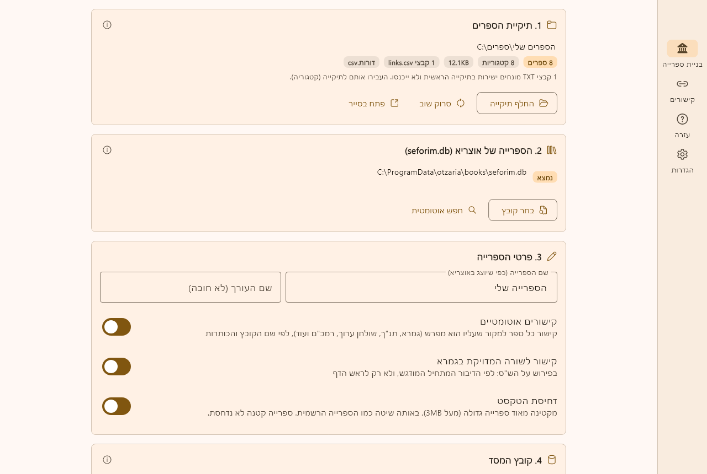

# ספרייה אישית לאוצריא - אופליין

תוכנה שבונה **ספרייה אישית לאוצריא** (קובץ מסד `.db`) מתיקיית ספרים במחשב, **עם קישורים לספרייה הרשמית**. הכול נעשה במחשב, **בלי חיבור לרשת** ובלי חשבון GitHub.

זו הגרסה האופליין של [MyLibraryforOtzaria](https://github.com/Tzadikvtovlo/MyLibraryforOtzaria): אותו מנוע בנייה ואותו מנוע קישורים ([מחולל הקישורים](https://github.com/YairDaniel11/Otzariya_Link_Maker)), בתוכנה אחת במקום בנייה בענן.



## מה צריך

- **אוצריא מותקנת במחשב.** התוכנה קוראת את הספרייה שלה (`seforim.db`) כדי ליצור ולאמת את הקישורים, בלי לשנות אותה. בלעדיה נבנית ספרייה בלי קישורים.
- ספרים בקבצי **TXT בפורמט אוצריא**, מסודרים בתיקיות.

## הורדה

בדף [Releases](../../releases) (בגרסה האחרונה):

- **Windows:** `MyLibraryOffline.exe`, קובץ אחד שרץ בלי התקנה. אפשר גם `MyLibraryOffline-windows.zip`, תיקייה רגילה.
- **Mac:** `MyLibraryOffline-macos.zip`. בפעם הראשונה: לחיצה ימנית על התוכנה ← פתח.

## איך משתמשים

1. בוחרים את **תיקיית הספרים**.
2. התוכנה מוצאת לבד את `seforim.db` של אוצריא. אם היא לא מוצאת אותו, בוחרים אותו ידנית.
3. נותנים שם לספרייה ובוחרים היכן לשמור את הקובץ.
4. לוחצים **בנה את הספרייה**.
5. באוצריא: **הגדרות ← ספרייה ← מסדי ספרים אישיים ← ייבא קובץ מסד**, ובוחרים את הקובץ שנוצר.

### מבנה התיקיות

```
הספרים שלי
  תלמוד בבלי
    סדר נזיקין
      חידושים על בבא מציעא.txt
  הלכה
    ביאור על שולחן ערוך אורח חיים.txt
  קבצי קישורים וסדר הדורות        (לא חובה)
    דורות.csv
    קישורים
      שלי
        links.csv
```

- כל תיקייה הופכת לקטגוריה באוצריא, ושם הקובץ הוא שם הספר.
- כותרות `<h1>` עד `<h6>` בתוך הספר הופכות לתוכן עניינים.
- לא נכנסים: קבצים שאינם TXT, קבצי README, וקבצים שמונחים ישירות בתיקייה הראשית.

## קישורים

### תלמוד בבלי

פירוש על מסכת מקושר לדף המתאים בגמרא כשמתקיימים שלושה תנאים:

1. הספר נמצא בתיקייה `תלמוד בבלי` (בכל תת-תיקייה, חוץ מ`שס וגשל`).
2. שם המסכת כתוב בשם הקובץ (או בכותרת `<h2>מסכת ...</h2>`).
3. כל דף מסומן בכותרת: `<h2>ב.</h2>` לעמוד א, `<h2>ב:</h2>` לעמוד ב (אפשר גם `יד, ב` או `דף ב ע"א`).

שורה שמתחילה בדיבור המתחיל מודגש (`<b>...</b>`) מקושרת **לשורה המדויקת** בגמרא, ולא רק לראש הדף.

### שאר הספרים (תנ"ך, שולחן ערוך, רמב"ם, ירושלמי ועוד)

התוכנה מחפשת בשם הקובץ את הספר שעליו הוא מפרש, בדרך כלל אחרי המילה "על". למשל `ביאור על שולחן ערוך אורח חיים.txt` מקושר ל"שולחן ערוך, אורח חיים". אחר כך היא מתאימה את הכותרות (`<h2>פרק א</h2>`, `<h2>סימן ב</h2>`, `<h3>הלכה ג</h3>`) למבנה ספר היעד. הקישור נכתב רק אם לפחות חצי משורות הספר נקשרו למקום שקיים באמת באוצריא.

**מסך "קישורים"** מראה לכל ספר אם קושר, לאיזה ספר ובאיזה כלל, או למה לא. שם אפשר לבחור **יעד ידנית** לספר שלא זוהה, או לבטל לו קישורים. הבחירה נשמרת לבניות הבאות. משם אפשר גם לייצא את הקישורים כ-`links.csv`.

### קישורים משלכם, מחברים ודורות

- קבצי `links.csv` ב`קבצי קישורים וסדר הדורות/קישורים/<שם>/` נכללים כמות שהם, והספרים שבהם לא מקבלים קישורים אוטומטיים.
- `דורות.csv` (עמודות: ספר, קטגוריה, דור, מחבר) מוסיף מחבר ודור.
- `<שם ספר>_links.json` ליד ספר יוצר קישורים בין ספרים שבספרייה שלכם.

## עדכון הספרייה

בונים שוב **לאותו קובץ**. המסד מתעדכן לגרסה הבאה, וספרים קיימים שומרים על המזהים שלהם. באוצריא מייבאים שוב את הקובץ.

## פרטים טכניים

- המסד נבנה בפורמט הספרייה האישית של אוצריא, ועובר את בודק המסדים של אוצריא (`tool/validate_personal_db.dart`).
- המנוע (`lib/src/engine`) הוא תרגום ל-Dart של `build_personal_db.py`, `auto_links.py`, `linker_core.py` ו-`dh_lines.py` מ-MyLibraryforOtzaria. על אותם ספרים הוא מפיק מסד זהה, טבלה מול טבלה.
- בספרייה גדולה (מעל 3MB טקסט) השורות נדחסות ב-zstd **עם המילון של הספרייה הרשמית** (סכמה 6), כמו המסד הרשמי עצמו.
- העבודה רצה ב-isolate נפרד, והממשק לא נתקע. אפשר לעצור בכל רגע, והקובץ הקודם נשאר שלם.

### בנייה מהקוד

```
flutter pub get
flutter test
flutter build windows
```

הבנייה ל-Windows דורשת Visual Studio עם "Desktop development with C++". ב-GitHub Actions כל שינוי ב-`main` נבנה ומתפרסם כ-Release.

בדיקת המנוע מול `seforim.db` אמיתי (לא רצה ב-CI):

```
set OFFICIAL_DB=C:\ProgramData\otzaria\books\seforim.db
set CORPUS_DIR=<תיקיית ספרים>
set OUT_DB=<קובץ פלט>
set ZSTD_LIB_PATH=<zstandard_windows.dll>
flutter test test/engine_build_test.dart
```

## אודות

פרויקט קהילתי שאינו קשור לתוכנת [אוצריא](https://github.com/Sivan22/otzaria) הרשמית.
